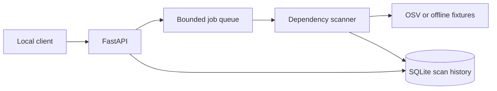

# DepScope

DepScope is a local-first dependency security project. It assesses exact Python requirements pins and npm lockfile entries against known advisories, explains coverage and fix evidence, and stores scan history in SQLite.

**Project status** · Phase 2 scanning engine, local REST API, and persistent scan history. The browser application is planned for Phase 3.

## Windows setup

From the workspace root, use Python 3.12. Installation downloads the service and development dependencies from PyPI into `.venv`.

```powershell
python --version
python -I -m venv --without-pip .venv
New-Item -ItemType Directory -Path .\.venv\tmp -Force | Out-Null
$env:TMP = (Resolve-Path .\.venv\tmp).Path
$env:TEMP = $env:TMP
$env:PIP_CONFIG_FILE = 'NUL'
$python = '.\.venv\Scripts\python.exe'
& $python -I -m ensurepip --default-pip
& $python -I -m pip --isolated --disable-pip-version-check --no-cache-dir install --index-url https://pypi.org/simple --only-binary=:all: --timeout 12 --retries 1 -e '.[dev]'
```

## Initialize the database and start the API

Run from the workspace root after installation. Alembic creates the database directory and applies the current schema. The service binds to IPv4 loopback and runs one worker.

```powershell
$python = '.\.venv\Scripts\python.exe'
& $python -m alembic upgrade head
& $python -m alembic current
& $python -m uvicorn depscope.service.api:create_app --factory --host 127.0.0.1 --port 8000 --workers 1 --no-access-log
```

In another PowerShell terminal, submit an offline sample and check its scan record.

```powershell
$api = 'http://127.0.0.1:8000'
Invoke-RestMethod "$api/api/health"
$scan = Invoke-RestMethod -Method Post -Uri "$api/api/scans?sample_id=python-vulnerable"
Invoke-RestMethod "$api$($scan.status_url)"
Invoke-RestMethod "$api$($scan.status_url)/findings"
Invoke-RestMethod "$api/api/scans?provenance=offline_fixture"
```

A new record starts at `queued` and can be polled until `complete`, `partial`, or `failed`. See the [API guide](docs/api.md) for request formats, offline database seeding, limits, errors, and upgrade procedures. The machine-readable OpenAPI schema is available at `/openapi.json`.

## Run the scanner directly

Scan the bundled examples offline and export one result to a new JSON file.

```powershell
$python = '.\.venv\Scripts\python.exe'
New-Item -ItemType Directory -Path .\artifacts -Force | Out-Null
$jsonReport = '.\artifacts\python-demo-' + [guid]::NewGuid().ToString('N') + '.json'
& $python -m depscope .\samples\requirements-vulnerable.txt --offline --json $jsonReport
& $python -m depscope .\samples\package-lock-vulnerable.json --offline
& $python -m depscope .\samples\requirements-clean.txt --offline
Get-Content -LiteralPath $jsonReport -Raw | ConvertFrom-Json
```

The fixture results are deliberately limited. Coordinates outside the fixture set are marked unassessed. Use `--format requirements` or `--format npm-lock` for files with other names. An explicitly requested `--live` scan sends exact package coordinates to `api.osv.dev`. The temporary interface exits with `0` for complete lookups, `1` for partial or failed lookups, and `2` for an input or export error. A completed scan can still contain unresolved entries.

See the [fixture sources](samples/README.md) and [verification commands](docs/testing.md).

## Coverage

Python requirements describe what is declared in that file. An npm lockfile can also describe locked transitive dependencies. The service reports exact, assessed, partial, failed, and unresolved entries. Live lookups send exact dependency coordinates to OSV when requested. Offline samples use a bundled subset of advisories and have separate provenance.

## Architecture



The service uses Python 3.12, FastAPI, Pydantic, HTTPX, SQLAlchemy, SQLite, and Alembic. It parses manifests as data, keeps raw bytes in memory, and stores normalized results and advisory snapshots. See the [threat model](docs/threat-model.md) and [current limitations](docs/limitations.md).

## Design documents

- [Architecture and scan flow](docs/architecture.md)
- [SQLite schema](docs/data-model.md)
- [Risk prioritization and scoring](docs/scoring.md)
- [Threat model](docs/threat-model.md)

## Roadmap

Phase 3 adds the responsive dashboard, scan workflow, history, and vulnerability explorer. Scan comparison and reports follow in Phase 4. CLI integration, Docker, and browser tests are planned for Phase 5.
