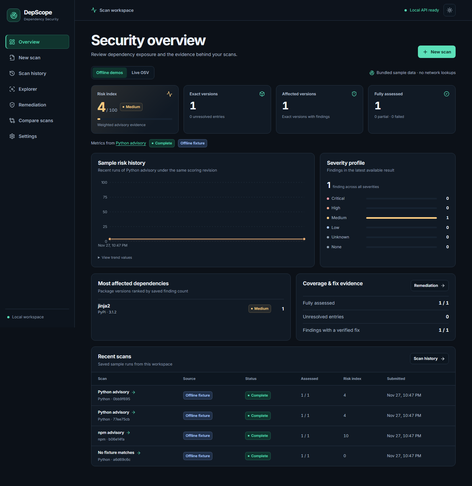

# DepScope

DepScope is a local dependency advisory scanner for Python requirements and npm lockfiles. The dashboard and CLI show which versions were assessed, what the advisory evidence supports, and where coverage is incomplete.

[Grouped findings](docs/images/scan-results.png) · [Remediation center](docs/images/remediation.png) · [Scan comparison](docs/images/scan-comparison.png)

## Purpose

A manifest can mix exact versions, ranges, and unsupported sources. An empty finding list has different meaning when every version was checked and when some versions could not be assessed. DepScope records that difference alongside each result so a reviewer can judge the evidence before acting on it.

## Features

- Assess exact Python `==` pins and npm lockfile v1–3 entries, including nested npm packages. Keep unresolved declarations visible.
- Run bundled offline examples or opt in to live lookups from the [Open Source Vulnerabilities database](https://osv.dev/).
- Group findings by advisory or package version and trace severity, aliases, and applicable fix evidence.
- Review remediation candidates, compare saved scans from the same source, and export JSON or a printable report.
- Apply a severity threshold using the CLI, including a comparison against a saved baseline. Incomplete evidence produces a nonzero policy result.

## Stack and layout

The backend uses Python, FastAPI, SQLAlchemy, Alembic, and SQLite. The dashboard uses React, TypeScript, and Vite. Pytest, Vitest, and Playwright cover the engine, UI, and complete workflows.

~~~text
backend/depscope/   scanner, CLI, API, and persistence
backend/tests/      scanner, API, storage, and CLI tests
frontend/src/      dashboard and report views
frontend/tests/    component and interaction tests
frontend/e2e/      browser checks backed by the offline service in e2e/
migrations/        SQLite schema migrations
requirements/      hash-pinned Python dependencies
samples/           public and synthetic scan inputs
docs/              design, verification, and deployment notes
~~~

## How a scan works

~~~mermaid
flowchart LR
    Dashboard[React dashboard] --> API[FastAPI]
    API --> Jobs[Bounded scan queue]
    CLI[DepScope CLI] --> Scanner[Scanner]
    Jobs --> Scanner
    Scanner --> Provider[OSV or bundled fixtures]
    Scanner --> Evidence[Findings and coverage]
    Evidence -->|Saved by API job or CLI| DB[(SQLite scan history)]
    API -->|Read saved results| DB
    CLI -->|Read history| DB
~~~

Both entry points use the same parser and matching engine. The scanner preserves the affected range and advisory ID behind each suggested fix. CVSS comes from advisory evidence, and the separate DepScope index summarizes weighted severity for triage. Saved results include normalized dependencies, evidence, and coverage. Raw manifest contents stay out of SQLite. [Architecture](docs/architecture.md) · [Data model](docs/data-model.md) · [Scoring](docs/scoring.md)

## Quickstart

Use CPython 3.12–3.14 and Node.js 22.22 or a compatible newer release. The commands use the checked-in Python and npm locks. [macOS, Linux, and Docker setup](docs/deployment.md)

### Windows setup

Run these commands from the repository root in PowerShell. The last command starts the local API.

~~~powershell
python -m venv .venv
$python = '.\.venv\Scripts\python.exe'
& $python -m pip install --require-hashes --only-binary=:all: -r requirements/build.txt -r requirements/dev.txt
& $python -m pip install --no-deps --no-build-isolation -e .
& $python -m alembic upgrade head
$env:DEPSCOPE_ALLOWED_ORIGINS = 'http://127.0.0.1:5173,http://127.0.0.1:4173'
& $python -m uvicorn depscope.service.api:create_app --factory --host 127.0.0.1 --port 8000 --workers 1 --no-proxy-headers --no-access-log
~~~

### Start the dashboard

Open a second PowerShell terminal at the repository root.

~~~powershell
Set-Location .\frontend
npm.cmd ci --ignore-scripts --cache ..\artifacts\npm-cache --no-audit --no-fund
npm.cmd run dev
~~~

Open `http://127.0.0.1:5173`. Choose **New scan → Offline sample → Python advisory**. Open the finding to see the exact version, advisory identifiers, and evidence for the fix. Run **Partial advisory data** to see how the app reports incomplete lookups.

## Scan from the CLI

Run this from the repository root. The CLI can scan without the server or dashboard.

~~~powershell
& .\.venv\Scripts\depscope.exe scan .\samples\requirements-vulnerable.txt --offline --format json
~~~

The bundled sample is intentionally vulnerable and is for scanning only. Do not install its dependencies. Use `--live` to send exact package names, ecosystems, and versions to OSV. [Sample inputs](samples/README.md) · [CLI and exit codes](docs/cli.md) · [CI policy example](docs/ci-policy.md)

## Tests

After the quickstart dependency installation, run from the repository root in PowerShell.

~~~powershell
New-Item -Path .\artifacts -ItemType Directory -Force | Out-Null
$testRun = '.\artifacts\pytest-' + [guid]::NewGuid().ToString('N')
& .\.venv\Scripts\python.exe -m pytest --basetemp $testRun --cov=depscope
npm.cmd --prefix .\frontend test
~~~

The standard tests use offline fixtures or mocks. See the [testing guide](docs/testing.md) for lint, type, packaging, and browser commands and the [verification record](docs/testing.md#phase-6-verification) for measured results.

## Limitations and roadmap

Python requirements describe declared pins. DepScope does not resolve an environment or determine runtime reachability. A recorded fixed version applies to the advisory evidence for that package version. Upgrade compatibility still needs application testing.

The API binds to loopback and is designed for a single local user. Future work can extend manifest coverage and compare advisories across more dependency formats. The project license and first hosted CI run remain pending. [Known limitations](docs/limitations.md) · [Security policy](SECURITY.md) · [Third-party notices](docs/third-party.md) · [Changelog](CHANGELOG.md)
