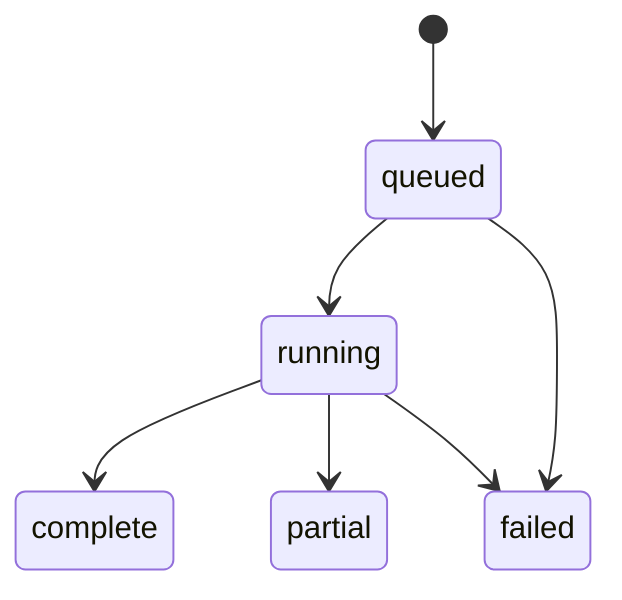

# Local scan API

Run the API on loopback with one Uvicorn worker. API responses and the schema at `/openapi.json` are available offline. Browser documentation is provided here so the service need not fetch documentation assets from a CDN.

## Routes

| Method and route | Purpose |
| --- | --- |
| `POST /api/scans` | Accept manifest bytes or a bundled sample ID. Returns `202`, `Location`, and an object with `id`, `status`, and `status_url`. |
| `GET /api/scans` | List scan summaries. Filter by `provenance`, `status`, or `format`. Sort by `newest`, `oldest`, or descending `risk` with unavailable scores last. |
| `GET /api/scans/{id}` | Poll a scan and retrieve its coverage, error code, dependency occurrences, and coordinate assessments. `page` and `page_size` apply independently to both collections. |
| `GET /api/scans/{id}/findings` | List findings and advisory evidence from that scan. Filter by `ecosystem`, `severity`, literal `package` substring, or `fix_available`. Sort by `priority` or `package`. |
| `GET /api/overview` | Return counts by state, recent scans, latest complete or partial result, and risk trend points in chronological order. Default provenance is `live_osv`. Use `provenance=offline_fixture` for demos. `limit` defaults to 10 and accepts 1–50. |
| `GET /api/health` | Check SQLite schema readiness. Returns `200` when ready and `503` if storage becomes unavailable. Health performs no OSV lookups. |

Paginated responses have `items`, `page`, `page_size`, and `total`. Page numbering starts at 1. The page size defaults to 20 and accepts 1–50. Scan IDs are UUIDs. Findings include the original priority and an observation list. The accompanying `advisories` map contains hydrated evidence for the page. Discovery-only entries still include their observed IDs and failure codes.

## Submit and seed scans from PowerShell

Send an empty body with `sample_id` for an offline scan. Available IDs are `python-vulnerable`, `npm-vulnerable`, `python-clean`, `python-mixed`, and `python-partial`. These submissions populate the current database with labeled samples and do not contact OSV. The following sequence waits for each sample before submitting the next.

```powershell
$api = 'http://127.0.0.1:8000'
foreach ($sampleId in @('python-vulnerable', 'npm-vulnerable', 'python-clean', 'python-mixed', 'python-partial')) {
    $accepted = Invoke-RestMethod -Method Post -Uri "$api/api/scans?sample_id=$sampleId"
    $deadline = (Get-Date).AddSeconds(30)
    do {
        Start-Sleep -Milliseconds 150
        $report = Invoke-RestMethod "$api$($accepted.status_url)"
        if ((Get-Date) -gt $deadline) { throw "Scan polling timed out for $sampleId" }
    } while ($report.scan.status -in @('queued', 'running'))
    $report.scan | Select-Object sample_id, status, provenance, risk_index
}
```

For a live scan, specify `format=requirements` or `format=npm-lock`, `source=upload` or `source=paste`, and `live=true`. Send the raw file bytes with `text/plain` for requirements, `application/json` for lockfiles, or `application/octet-stream` for either. A live request sends exact dependency coordinates to OSV.

```powershell
$manifestPath = '.\samples\requirements-vulnerable.txt'
$scanUri = "$api/api/scans?format=requirements&source=upload&live=true"
$accepted = Invoke-RestMethod -Method Post -Uri $scanUri -InFile $manifestPath -ContentType 'text/plain'
Invoke-RestMethod "$api$($accepted.status_url)"
```

## States, limits, and errors



- `complete` and `partial` include normalized scan coverage. A `failed` lookup can also include coverage and coordinate diagnostics. Input parsing, interruptions, and processing errors yield a `failed` record with an `error_code`. Pending and pre-result failures have null coverage and risk fields.
- The default cap is **1,000,000 bytes**, checked from the declared size and while streaming. Uploads must finish within **10 seconds**. One scan runs at a time. The queue allows **four additional slots** and in-progress uploads also occupy slots. Requests are globally limited to **30 admitted submissions per 60 seconds**. The job scan budget is **60 seconds** and the OSV gateway has its own **45-second** limit.
- Request errors have an `error` object with `code` and `message`. Invalid input metadata returns `422`; incorrect media or compression returns `415`; over-limit bodies return `413`; uploads that exceed the time limit return `408`. Queue saturation returns `503` with `scan_queue_full` and rate limiting returns `429` with `submission_rate_limited`. Those responses include `Retry-After`.
- The API validates the `Host` header and checks the browser `Origin` for writes and preflight requests. Direct local clients may omit `Origin`. Configure additional loopback origins in `DEPSCOPE_ALLOWED_ORIGINS` for local development.
- One worker owns the database via an OS file lock. On shutdown or startup, orphaned `queued` and `running` records become `failed` with `interrupted`. Resubmit interrupted scans. The original upload is unavailable for automatic recovery. Completed snapshots survive process restarts.

## Initialization, upgrades, and troubleshooting

Run Alembic from the source workspace with the same `DEPSCOPE_DB_PATH` setting used at launch. The default is `data/depscope.sqlite3`. Database paths must be inside this workspace and end in `.sqlite3`, `.sqlite`, or `.db`. See [the settings example](../.env.example) for other environment variables.

```powershell
$python = '.\.venv\Scripts\python.exe'
& $python -m alembic upgrade head
& $python -m alembic current
& $python -m alembic check
```

For an existing database, stop Uvicorn before upgrading. Back up the SQLite file first. The worker lock blocks migrations while the API owns the database.

```powershell
New-Item -ItemType Directory -Path .\artifacts -Force | Out-Null
$dbPath = if ($env:DEPSCOPE_DB_PATH) { $env:DEPSCOPE_DB_PATH } else { '.\data\depscope.sqlite3' }
$backup = '.\artifacts\depscope-backup-' + [guid]::NewGuid().ToString('N') + '.sqlite3'
Copy-Item -LiteralPath $dbPath -Destination $backup
& $python -m alembic upgrade head
```

If startup reports a missing or incompatible schema, check the configured path and run `alembic upgrade head`. If another worker owns the database, stop that instance before starting the service or running migrations. If live OSV requests fail, inspect the scan's coordinate diagnostics and use a labeled offline sample to verify the local pipeline. The [test guide](testing.md) covers local verification without live requests.
