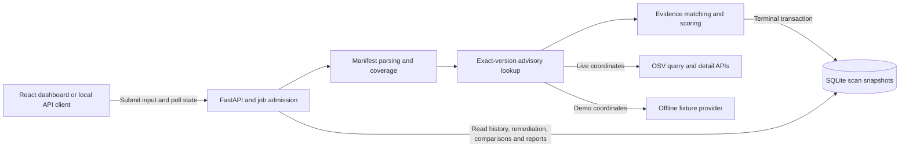

# Architecture and scan flow

The scanner runs independently of HTTP routes, SQLite, and a browser. Its entry point is `Scanner.scan(bytes, format)`. The CLI uses the same engine and can optionally save evidence in SQLite. Vite serves the dashboard during development and proxies API requests to `127.0.0.1:8000`. In production, the same FastAPI process serves the built dashboard and API from one origin.

## Boundaries

| Component | Responsibility |
| --- | --- |
| Parser | Parse bounded bytes into typed dependency occurrences and coverage metadata. Preserve unsupported entries and safe diagnostic codes. |
| Advisory client | Accept unique exact coordinates, discover IDs, fetch full advisories, and return evidence and explicit per-coordinate lookup states. Own transport, retry, pagination, and cache bounds. |
| Matching and scoring | Correlate advisory evidence to package/version identity, consolidate aliases, evaluate fix evidence, and compute explainable priority. Tests can invoke this logic with in-memory inputs. |
| Persistence | Use SQLAlchemy and Alembic to store normalized input and snapshots of findings. Derive UI views and exports from the same saved results. |
| API | Validate and schedule work, expose job states and results, and describe the response models through OpenAPI. |

## Scanner pipeline

1. Decode bounded UTF-8 bytes and create normalized occurrences. Keep unresolved and invalid entries with reason codes. Deduplicate exact coordinates after recording occurrences and paths.
2. Query exact coordinates through an injected advisory provider. The live client batches positional results, follows per-coordinate page tokens and fetches each discovered advisory ID once per lookup. Offline demos use an HTTPX mock transport through the same gateway. Coordinates outside the fixture catalog are marked unavailable.
3. Verify that hydrated advisory evidence covers the coordinate. Preserve discovery-only IDs where details are unavailable or local matching cannot confirm scope. Retain withdrawn advisory observations for inspection and exclude them from active findings. Deduplicate only using explicit aliases on the same coordinate.
4. Sort findings by documented priority. Return coverage and evidence in immutable scan records. The versioned JSON export references one copy of each hydrated advisory across all coordinate assessments. Input failures produce safe error codes. The job worker stores them on the affected scan.

The query and detail caches are separately bounded and expire after five and fifteen minutes by default. Cached details must be at least as recent as the discovery timestamp. Incomplete discovery is never cached. If discovery succeeds and detail retrieval fails, the next scan can reuse the discovery IDs and retry hydration. Offline CLI scans work without SQLite and use a catalog included in the wheel. [OSV querybatch](https://google.github.io/osv.dev/post-v1-querybatch/) · [OSV advisory endpoint](https://google.github.io/osv.dev/get-v1-vulns/) · [OSV schema](https://ossf.github.io/osv-schema/)

## Service lifecycle

1. An upload or paste submission sends a bounded raw request body with `live=true`, the chosen format, and the source. The API reserves capacity before streaming the body. A demo submission selects a bundled fixture by server-known ID. The API creates a scan record and returns its ID and `queued` status.
2. The worker transitions the scan to `running`, parses the input in memory, and records occurrences, exact coordinates, and unresolved reasons. The raw bytes are discarded after the job. Each lookup key contains an ecosystem, normalized package name, and exact version.
3. For live scans, the gateway sends coordinates to OSV `/v1/querybatch` and follows pagination per query. A missing, malformed, or uncorrelated result makes the affected queries incomplete. The gateway hydrates deduplicated IDs from the OSV vulnerability detail endpoint. Positive IDs from discovery may coexist with a partial status if detail retrieval fails. Those findings retain their ID and discovery provenance and carry no inferred severity or fix.
4. The engine validates package and version evidence, groups equivalent IDs, records supported severity and fixes, and computes coverage and risk. It retains withdrawn or contradictory evidence as a diagnostic and withholds fix recommendations based on it. It commits the snapshot and terminal status together. Polling displays `queued`, `running`, `complete`, `partial`, or `failed` with actual status and available counts.
5. Overview, history, and reports read the saved snapshot, including lookup failures, assessment time, and source. Trend points carry their own coverage. Demo scans run through the same engine with a fixture provider and carry demo provenance from submission through export.

`complete` indicates that all intended lookups completed, including inputs with no eligible exact coordinates. `partial` indicates that some lookup or advisory results are missing and there is usable evidence. `failed` covers rejected parsing after admission, loss of all usable advisory results, interrupted work, or a processing error. Unresolved dependency versions affect coverage independently of job status. The overview should display assessed coordinates and unresolved occurrences alongside the job state.

## Manifest coverage

- For Python, parse a single requirements file with PEP 508/440-aware tooling. A single concrete `==` pin represents a declared version. Preserve extras as declaration metadata. Treat ranges, wildcards, unpinned names, URLs, editables, includes, and environment-dependent lines without an explicit target as unresolved. Conflicting unconditional pins and file-wide index or find-links overrides suppress affected public lookups. The parser does not resolve includes or invoke packaging commands.
- For npm lockfile v1, traverse the nested `dependencies` tree and evaluate concrete registry package versions. A package at the root of the installed tree may be hoisted, so directness can be unknown. For v2/v3, inspect the `packages` map and use root declarations to identify top-level direct dependencies. Preserve occurrence paths for nested packages and deduplicate identical lookups. Treat local/workspace links, bundled dependencies, explicit private or non-registry sources, and ambiguous aliases as unresolved. An exact record with no source metadata can be assessed under the default public-registry assumption. [npm lockfile format](https://docs.npmjs.com/cli/v11/configuring-npm/package-lock-json/)
- Record occurrence counts, distinct exact coordinates, and successfully assessed coordinates as separate measures. Developer and optional packages in a lockfile are part of the input inventory. Runtime installation, reachability, and dependency paths beyond the supported manifest remain outside coverage.

## API scope

| Route | Contract |
| --- | --- |
| `POST /api/scans` | Accept bounded manifest bytes with explicit format and upload/paste metadata, or a bundled sample ID. Return `202` with a scan ID and polling URL. |
| `GET /api/scans` | Return paginated, newest-first scan summaries with stable ordering and provenance filtering. |
| `GET /api/scans/{id}` | Return status, coverage, normalized dependencies, and scan metrics. Paginate large dependency lists. |
| `GET /api/scans/{id}/findings` | Return filterable, paginated findings and detail evidence. |
| `GET /api/scans/{id}/packages` and `/review` | Aggregate findings by exact coordinate and paginate unresolved inventory. |
| `GET /api/scans/{id}/candidates` | Combine an advisory's applicable fix evidence with same-source exact-version lookup evidence from history. |
| `GET /api/scans/{id}/comparison/{other_id}` | Compare immutable saved results by normalized package and explicit advisory identities. |
| `GET /api/scans/{id}/report` | Read the saved scan and its evidence into a versioned report in one database read transaction. |
| `GET /api/overview` | Return summaries computed from selected provenance and scan history, with partial and missing data represented explicitly. |
| `GET /api/health` | Report local service and storage readiness without creating an OSV request. |

Use consistent error objects with a stable code and a user-readable message. Enforce the byte limit as data arrives, even when `Content-Length` is absent or incorrect. Use `413` for oversized input, `415` for unsupported media, `422` for invalid request metadata, `429` for rate limits, and `503` when job admission is at capacity. Async parse or lookup failures become scan states with safe diagnostics. Provide generated OpenAPI documentation.

One process owns the SQLite file through an OS lock, and one worker executes jobs. Shutdown cancels an active advisory lookup, waits for any storage operation already underway, and reconciles pending jobs. Startup reconciles abandoned jobs before admitting new work. The user can resubmit interrupted inputs. See the [API guide](api.md) for status, configuration, rate limits, and migrations.

## Saved-result analysis

Findings and dependency groups share SQL filters. A group represents an exact ecosystem, name, and version. The overview derives its affected-dependency ranking from those same groups. JSON exports and the printable HTML report use the same saved-result payload. Candidate evidence, comparisons, and reports use the existing schema and add no migration or outbound transport.

The dashboard draws a risk history line only for repeated runs of the same bundled sample on the same scoring revision. Live history appears as independent points because uploads carry no persistent project identifier. The comparison screen lets the user choose a baseline and target and shows the coverage available for that specific pair.

CLI history and report readers open SQLite read-only. CLI writes take the same exclusive worker lock as the API and migrations. Console comparisons call the same comparison logic as the API and can add a severity policy.
