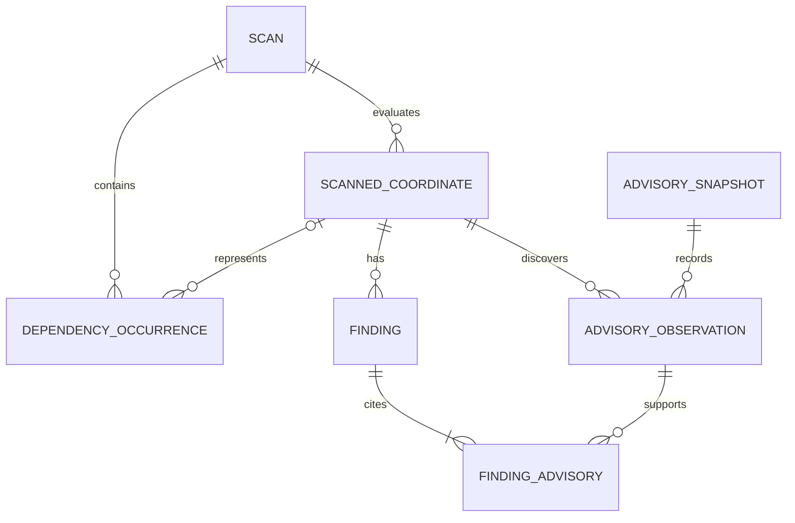

# SQLite data model

SQLite holds immutable observations from terminal scan attempts. Scan lifecycle fields may change until the terminal state is committed. Each scan uses its own evidence snapshots so a later OSV update can affect a future scan while the earlier result retains the evidence available at scan time.

The storage schema follows the scanner's JSON contract. It separates occurrences, coordinate assessments, findings, and advisory evidence. Discovery-only and withdrawn observations are retained. Timestamps are UTC and lookups have explicit `complete`, `partial`, or `failed` statuses.

| Table | Stored data and constraints |
| --- | --- |
| `scans` | UUID, UTC lifecycle and observation timestamps, format, source, live/demo provenance, bundled sample ID when applicable, state, error code, coverage, scoring revision, and risk index. |
| `dependency_occurrences` | Scan ID, position, normalized occurrence payload, and nullable coordinate ID. The payload can include a source line number or normalized installation path, version specifier, directness, and resolution reason. A composite foreign key restricts coordinate links to the same scan. |
| `scanned_coordinates` | Scan ID, ecosystem, normalized name, exact version, lookup status, and safe diagnostic codes. Unique on scan, ecosystem, name, and version. |
| `advisory_snapshots` | OSV ID, first captured timestamp, provenance, evidence level, SHA-256 content hash, and validated payload. Hydrated records include upstream dates, aliases, summary, affected ranges, severity evidence, and safe reference links. Identical snapshots are reused within the same provenance. |
| `advisory_observations` | Per-coordinate discovery ID and metadata, snapshot link, and optional hydration error. Stores observations even when they contribute no active finding. |
| `findings` | Coordinate ID, deterministic representative advisory ID, effective severity and evidence source, score/vector details when available, and applicable fix evidence with supporting advisory IDs. Unique on coordinate and representative ID. |
| `finding_advisories` | Join from a finding to its supporting observations. Composite foreign keys keep both ends within the same coordinate. |

Alembic revision `0001_scan_history` creates the schema. Every connection enables foreign keys. History is indexed by requested time and ID, with an additional index by provenance. Coordinates, finding positions, severity filters, and advisory joins also have indexes. A scan's terminal state, coverage, normalized rows, and advisory joins commit together. The repository checks the expected prior state on each transition. Failed writes roll back the full result.

## Assessment and aggregates

An occurrence represents one declaration or lockfile entry. Multiple occurrences can share a coordinate and one lookup. A coordinate can have no findings, one finding, or several. Its lookup status differentiates a successful empty result from a skipped or incomplete lookup. Produce the vulnerable dependency count from distinct coordinates with findings and use occurrence counts for the input inventory. Label the two units in dashboard views and reports.

Findings use a within-scan advisory representative with references to the full evidence. Equivalence comes from explicit OSV aliases, within the same package coordinate. Representative IDs can change when new aliases appear. Use the stored evidence, alongside the scoring revision, to interpret historical trend points.

## Scan comparisons

Compare within ecosystem and normalized package name, grouping records by overlap in their advisory ID and alias sets. Retain the exact version sets from each scan to show membership and version changes. Show matched groups as unchanged findings even when affected versions differ, with version differences explicit. Show evidence present on one side as newly detected or no longer detected where comparison coverage permits.

When the other scan lacks a successful lookup for the relevant package or source coverage changed, expose whether the package was removed, unresolved, unavailable, or unassessed. Changes in provider provenance or evidence completeness can make a comparison indeterminate. Disappearance alone does not establish remediation.
